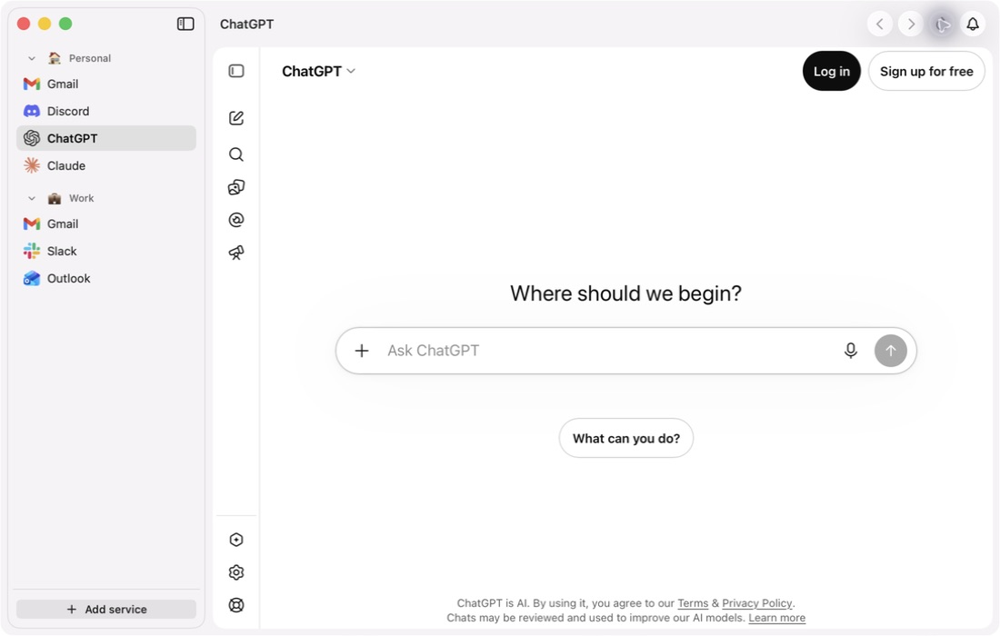

<!--
Source for the GitHub organisation profile at github.com/anguria-studio.
Publish by copying this directory verbatim to profile/ in a public repo
named .github under the org; a private .github repo renders nothing.
App copy follows lib/dictionaries/en.ts in the website repo. The images
are public/paguro/workspace{,-light}.png from that repo, converted with
cwebp -z 9; regenerate them from there, not by editing these.
-->

# Anguria Studio

Three small, free, open-source utilities for your Mac: Obolo, Scolo and Paguro.

Each one does one thing and keeps everything on your Mac. No accounts,
no telemetry, no subscriptions.

<picture>
  <source media="(prefers-color-scheme: dark)" srcset="media/paguro-dark.webp">
  
</picture>

## Apps

- **Paguro** — Native workspace for web apps. Messages, mail and everyday
  web tools in one window. Available now.
- **Obolo** — Subscription tracker. Not yet released.
- **Scolo** — Mac cleaner. Remove files safely; tell useful and useless
  apart. Not yet released.

Paguro is a fork of [Chorus](https://github.com/nicojan/Chorus) by Nico Jan.

## Requirements

Paguro runs on macOS 15 or later, Apple silicon and Intel. Obolo and Scolo
will need macOS 14 or later.

## Where to go

- Paguro: https://anguria.studio/paguro/
- Paguro privacy policy: https://anguria.studio/paguro/privacy/
- Source: https://github.com/anguria-studio/Paguro

## Contact

Found a bug in Paguro? [Open an issue](https://github.com/anguria-studio/Paguro/issues).
Anything else: hello@anguria.studio.
